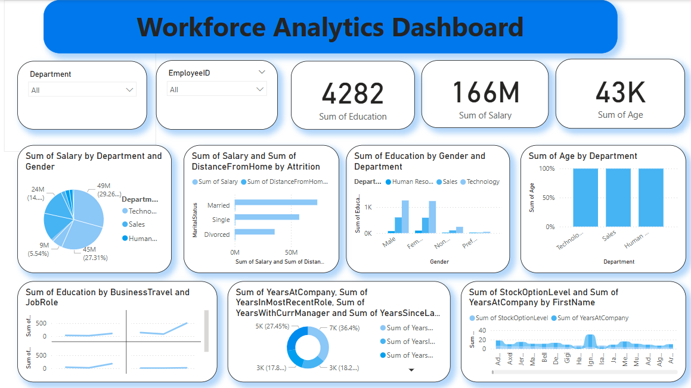

# HR Analytics Dashboard (Power BI)

An interactive Power BI dashboard that analyzes 1,470 employee records to explore workforce structure, compensation and tenure.

## Dataset
- **Records:** 1,470 employees
- **Columns:** 23 (employee info, department, job role, gender, marital status, salary, years at company, hire date, and more)
- **File:** `data/hr_data_clean.csv`
- **Source:** [add the source of the data here]

## Data Preparation (Power Query)
- Loaded the data from a CSV file
- Converted column data types (text, whole numbers, dates)
- Split the hire date into separate columns
- Calculated years since hire (rounded up)

## Dashboard Contents
- **KPI cards:** summary totals for age, salary and education
- **Slicers:** filter by employee ID and department
- **Charts:**
  - 100% stacked column chart (by department)
  - Clustered column chart (by gender and department)
  - Clustered bar chart (salary and distance from home by marital status)
  - Pie chart (salary by department and gender)
  - Donut chart (years at company, in current role, with current manager and since last promotion)
  - Ribbon chart (stock option level and years at company)
  - Line chart (by business travel and job role)
- **Page 2:** pie chart of salary and age by department

## Tools
- Power BI Desktop
- Power Query
- DAX (date tables)

## How to Use
1. Download `Dash_Board.pbix`.
2. Open it in Power BI Desktop.
3. If asked about the data source, point it to `data/hr_data_clean.csv`.

## Author
**Abanoub Rezk**
[LinkedIn](https://www.linkedin.com/in/abanoub-rezk) | [GitHub](https://github.com/AbanobRezk)
